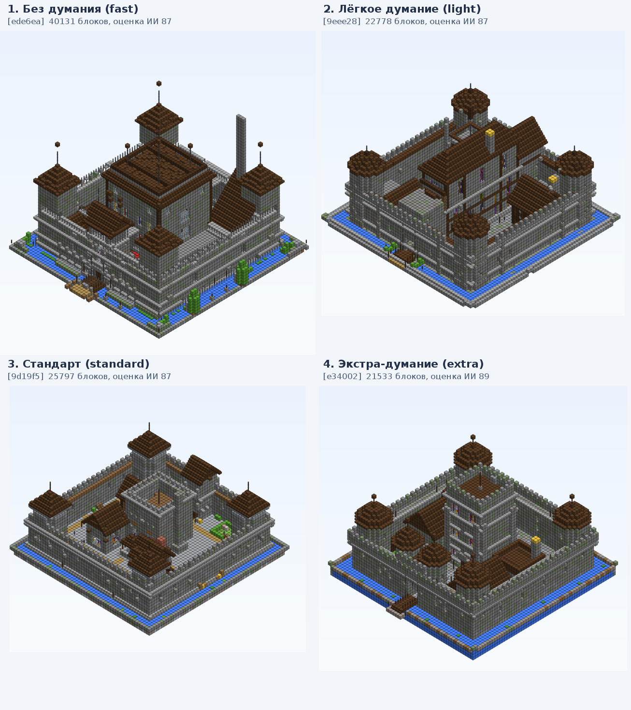

# AIBuild — ИИ-строитель построек для Minecraft

Плагин для Paper/Purpur **26.3** (Java 25): генерирует детальные постройки с нуля и изменяет существующие
с помощью **DeepSeek V4.1 Flash** через подписку **Command Code**. Каждая постройка проектируется по плану,
строится по этапам и проходит **самопроверку ИИ** по чек-листу, после чего ставится в мир с историей версий.



## Возможности

* `/aib create <описание>` — постройка с нуля: план → этапы (фундамент, стены, крыша, интерьеры, двор) → самопроверка.
* `/aib edit <запрос>` — изменение в любой момент: план изменения (область, шаги, критерии приёмки) → постройка → проверка по критериям.
* `/aib chat` — режим диалога: каждое сообщение в чат = запрос к ИИ.
* Самопроверка экспертами (конструктив / экстерьер / интерьер) по чек-листу: ИИ сам решает, когда проверка завершена.
* Режимы думания: `fast` (без думания), `light`, `standard`, `extra` — выбираются `/aib mode` или `--mode`.
* Версии и откат (`/aib undo`, `/aib redo`), рендер в PNG (`/aib render`), импорт ручных построек под ИИ-редактирование.
* `/aib bench` — A/B-сравнение схем на одинаковых входных данных со слепым судьёй.

Подробности: [plugin/README.md](plugin/README.md) (команды, конфиг), [DESIGN.md](DESIGN.md) (архитектура).

## Установка

1. Соберите плагин: `cd plugin && mvn -Dmaven.test.skip=true package` (или возьмите `AIBuild.jar` из релизов).
2. Положите `AIBuild.jar` в `plugins/` сервера Paper/Purpur 26.3 и перезапустите сервер.
3. В `plugins/AIBuild/config.yml` укажите ключ Command Code (`api.key`, вид `user_...`) — ключ хранится только
   в конфиге на сервере; вместо него можно задать переменную окружения `COMMANDCODE_API_KEY`.
4. `/aib mode` — выбрать режим думания, `/aib create <описание>` — построить.

## Режимы думания (замеры на замке 50×50)

| Режим | Время | Оценка ИИ | Проблем по автопроверке |
|---|---|---|---|
| `fast` — без думания | 6,5 мин | 87 | 9 |
| `light` — лёгкое | 23 мин | 87 | 10 |
| `standard` — стандарт | 18 мин | 87 | 8 |
| `extra` — экстра | 39 мин | 89 | 0 |

## Разработка

```
plugin/                 исходники плагина (Maven, paper-api 26.3)
plugin/src/test/java    самопроверочные тесты модулей (java -cp … <Class>)
tools/panel.mjs         управление тестовым сервером через панель Pterodactyl
tools/bench_summary.py  сводка бенчмарков
renders/                примеры построек
```

Тесты: `ChecklistCheck`, `OrientationCheck`, `LargeBuildCheck`, `AnalysisCheck`, `OpsCheck`, `WorldMathCheck`,
`PlacerCheck`, `ModesCheck`, `LlmUnitTests` — все проходят.

## Лицензия

MIT — см. [LICENSE](LICENSE).
